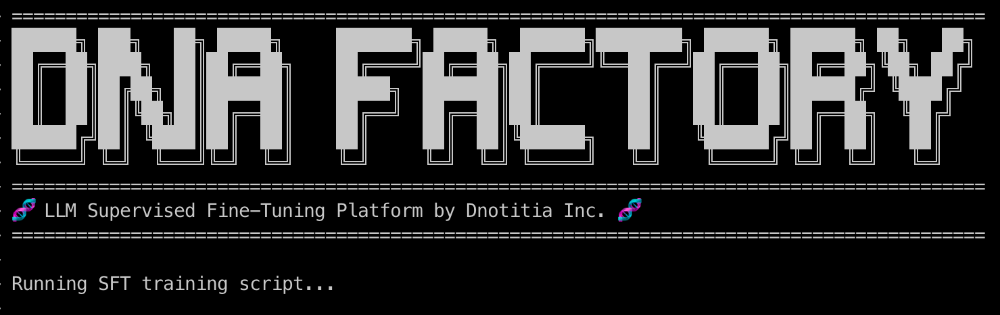

# DNA Factory



*"It Just Works!"*

A lightweight, opinionated stack for LLM Post-Training on Hugging Face TRL + DeepSpeed.
Five trainers share one setup/train/save path: **SFT** on instruction or conversation data,
**DPO** on chosen vs rejected pairs, **GRPO** as online RL scored by reward functions,
**OPD** (On-Policy Distillation) where a frozen teacher grades the student's own tokens,
and **SDFT** (Self-Distillation Fine-Tuning) where the model itself, shown a privileged
context the student never sees, acts as its own teacher.

- [News](#news)
- [Design Principles](#design-principles)
- [Key Features](#key-features)
- [How to Run](#how-to-run)
  - [Advanced Usage](#advanced-usage)
  - [Multi-GPUs](#multi-gpus)
  - [Multi-Nodes](#multi-nodes)
- [Acknowledgments](#acknowledgments)

# News

- Nov/03/2026 - **SDFT** (Self-Distillation Fine-Tuning) support.
- Oct/23/2026 - **Qwen3.8-Flash-Next** LoRA SFT support.
- Oct/12/2026 - Optional **unsloth** backend (single GPU) for SFT, DPO, GRPO and OPD.
- Sep/22/2026 - **Checkpoint Evaluation** - Inspect benchmarks on every checkpoint, logged to W&B.
- Sep/02/2026 - **OPD** (On-Policy Distillation) support.
- Jun/05/2026 - **GRPO** (Group Relative Policy Optimization) support.
- Oct/29/2025 - **DPO** (Direct Preference Optimization) support.
- Sep/21/2025 - **DNA Factory** is born! 🎉


# Design Principles

- **One Way Approach** — one proven choice per decision (e.g. DeepSpeed over FSDP).
- **Lightweight Design** — no bloat beyond core functionality.
- **Clean and Readable Code** — every line understandable by any developer.

# Key Features

1. **Color-coded logging** across huggingface_hub, datasets, tokenizers, transformers, torch, accelerate, and trl.
1. **Auto-generated output directory** from the model name and CLI args (e.g. `Qwen3-0.6B-SFT-num_train_epochs-2-...`).
1. **Commented default YAMLs** (`configs/_defaults-*.yaml`), overridable by custom YAML or CLI args.
1. **Ready-made accelerate configs** for DDP and DeepSpeed ZeRO-1/3 (+ CPU offload).
1. **Flexible checkpoint interval** — save on a wall-clock schedule (e.g. `6h`) instead of a step count.
1. **Benchmarks on every checkpoint** — each checkpoint is served with vLLM on a spare GPU, scored with Inspect, and logged to the same W&B run, so eval curves land next to the loss curve while training keeps running; see [docs/checkpoint-eval.md](docs/checkpoint-eval.md).

# How to Run

```bash
$ uv sync
$ source .venv/bin/activate

# SFT — supervised fine-tuning on labeled instruction/response (or conversation) data.
$ python sft.py
```

For a short first run on one GPU, use the [public-data quick start](docs/quickstart.md).
It trains for just two steps on 32 Capybara conversations, without Hugging Face or W&B login:

```bash
$ python sft.py --config configs/SFT/qwen3-0.6B-public-smoke.yaml
```

Beyond SFT, DPO, GRPO, OPD, and SDFT are also available:

```bash
# DPO — preference learning on chosen vs rejected responses.
$ python dpo.py

# GRPO — online RL: generate completions and score them with reward functions.
$ python grpo.py

# OPD (On-Policy Distillation) — student completions scored token-wise by a frozen teacher.
$ python opd.py

# SDFT — Self-Distillation Fine-Tuning.
$ python sdft.py
```

## Advanced Usage

CLI options, custom YAML, or both (CLI wins):

```bash
$ python sft.py \
  --model_name_or_path Qwen/Qwen3-0.6B \
  --dataset_name dnotitia/Reasoning_R1_Kor_completion_25k_sharegpt_v1 \
  --num_train_epochs 2

$ python sft.py \
  --config configs/SFT/qwen3-0.6B-korean-sft.yaml

$ python sft.py \
  --config configs/SFT/qwen3-0.6B-korean-sft.yaml \
  --num_train_epochs 2
```

> **Note:** The `dnotitia/Reasoning_R1_Kor_completion_25k_sharegpt_*` datasets used in these
> examples are not publicly downloadable; without Hugging Face access to them, `sft.py` fails
> with `DatasetNotFoundError`. To try the commands without that access, use a public dataset
> such as `trl-lib/Capybara` or the [public-data quick start](docs/quickstart.md).

## Multi-GPUs

DDP for speed, DeepSpeed ZeRO to save memory (ZeRO-1 and ZeRO-3 are supported):

```bash
$ accelerate launch \
  --config_file accelerate_configs/multi_gpu.yaml \
  --num_processes 2 \
  sft.py

$ accelerate launch \
  --config_file accelerate_configs/zero1.yaml \
  --num_processes 2 \
  sft.py \
  --config configs/SFT/qwen3-0.6B-korean-sft.yaml
```

## Multi-Nodes

See [multi-nodes.md](docs/multi-nodes.md) for the master/worker launch commands.

Guides for each training method and feature are listed in [docs/README.md](docs/README.md).

# Acknowledgments

This project is made possible thanks to:

- HuggingFace TRL <https://github.com/huggingface/trl>


- NIPA 오픈소스 지원 프로그램 <https://www.nipa.kr>


- NIA 한국지능정보사회진흥원 <https://www.nia.or.kr>
