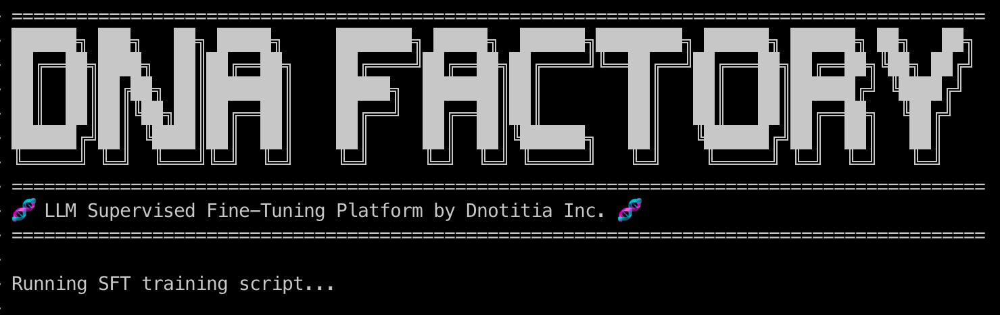

# DNA Factory



*"It Just Works!"*

A lightweight, opinionated stack for LLM Post-Training on Hugging Face TRL + DeepSpeed.
Four trainers share one setup/train/save path: **SFT** on instruction or conversation data,
**DPO** on chosen vs rejected pairs, **GRPO** as online RL scored by reward functions,
and **On-Policy Distillation** where a frozen teacher grades the student's own tokens.

- [DNA Factory](#dna-factory)
- [News](#news)
- [Design Principles](#design-principles)
- [Key Features](#key-features)
- [How to Run](#how-to-run)
  - [Advanced Usage](#advanced-usage)
  - [unsloth (single GPU)](#unsloth-single-gpu)
  - [Multi-GPUs](#multi-gpus)
  - [Multi-Nodes](#multi-nodes)
  - [Qwen3.8-Flash-Next](#qwen38-flash-next)
- [Acknowledgments](#acknowledgments)

# News

- Oct/23/2026 - **Qwen3.8-Flash-Next SFT** now supported with more **faster QSA indexer** and **PLE offloading**!
- Oct/12/2026 - Optional **unsloth** backend (single GPU) for SFT, DPO, GRPO and distillation.
- Sep/22/2026 - **Checkpoint Evaluation** — Inspect benchmarks on every checkpoint, logged to W&B.
- Sep/02/2026 - **On-Policy Distillation** support.
- Jun/05/2026 - **GRPO (Group Relative Policy Optimization)** support.
- Oct/29/2025 - **DPO (Direct Preference Optimization)** support.
- Sep/21/2025 - **DNA Factory** is born! 🎉


# Design Principles

- **One Way Approach** — one proven choice per decision (e.g. DeepSpeed over FSDP).
- **Lightweight Design** — no bloat beyond core functionality.
- **Clean and Readable Code** — every line understandable by any developer.

# Key Features

1. **Color-coded logging** across huggingface_hub, datasets, tokenizers, transformers, torch, accelerate, and trl.
1. **Auto-generated output directory** from the model name and CLI args (e.g. `Qwen3-0.6B-SFT-num_train_epochs-2-...`).
1. **Commented default YAMLs** (`configs/_defaults-*.yaml`), overridable by custom YAML or CLI args.
1. **Ready-made accelerate configs** for DDP and DeepSpeed ZeRO-1/3 (+ CPU offload).
1. **Flexible checkpoint interval** — save on a wall-clock schedule (e.g. `6h`) instead of a step count.
1. **Weighted dataset mixtures** via a per-dataset `weight:` (upsample, downsample, or drop) instead of listing the same path N times.
1. **Composable GRPO rewards** — TRL builtins or dotted paths (judge / string-match / shaping); returning `None` skips a sample so several rewards can share one labeled mixture.
1. **GRPO dynamic sampling** (`off` / `mask` / `resample`) — drop or refill zero-advantage groups so they don't waste a backward pass.
1. **AsyncGRPO** — generation decoupled onto a separate vLLM GPU, with token-budget batching and staleness metrics; see [docs/async-grpo.md](docs/async-grpo.md).
1. **Benchmarks on every checkpoint** — each checkpoint is served with vLLM on a spare GPU, scored with Inspect, and logged to the same W&B run, so eval curves land next to the loss curve while training keeps running; see [docs/checkpoint-eval.md](docs/checkpoint-eval.md).

# How to Run

```bash
$ uv sync
$ source .venv/bin/activate

# SFT — supervised fine-tuning on labeled instruction/response (or conversation) data.
$ python sft.py
```

Beyond SFT, DPO, GRPO, and On-Policy Distillation are also available:

```bash
# DPO — preference learning on chosen vs rejected responses.
$ python dpo.py

# GRPO — online RL: generate completions and score them with reward functions.
$ python grpo.py

# On-Policy Distillation — student completions scored token-wise by a frozen teacher.
$ python distill.py
```

## Advanced Usage

CLI options, custom YAML, or both (CLI wins):

```bash
$ python sft.py \
  --model_name_or_path Qwen/Qwen3-0.6B \
  --dataset_name dnotitia/Reasoning_R1_Kor_completion_25k_sharegpt_v1 \
  --num_train_epochs 2

$ python sft.py \
  --config configs/SFT/qwen3-0.6B-sft.yaml

$ python sft.py \
  --config configs/SFT/qwen3-0.6B-sft.yaml \
  --num_train_epochs 2
```

## unsloth (single GPU)

`use_unsloth: true` loads the model through [unsloth](https://github.com/unslothai/unsloth)'s `FastModel` and its patched TRL trainers, for all four scripts. It is an optional extra and single-GPU only (no DeepSpeed, no AsyncGRPO). It follows the same configuration as without it: a setting unsloth cannot honour stops the run or prints a warning instead of being changed silently, and where the computation differs (kernels, packing groups, unsloth's own GRPO/distillation loss code) is listed in the guide. Supported `model_type`s are `qwen3`, `qwen3_moe`, `qwen3_5` and `qwen3_5_moe`; other models fall back to the standard path with a warning (an unreadable model `config.json` stops the run with an error instead). Write the flag out in full, as `--use_unsloth true`:

```bash
$ uv sync --extra unsloth
$ python sft.py --config configs/SFT/qwen3-0.6B-sft-unsloth.yaml

# Any script, any config
$ python dpo.py --use_unsloth true --use_peft true --lora_dropout 0.0
```

Full guide, including an example GRPO config, when it helps and what it changes: [docs/unsloth.md](docs/unsloth.md).

## Multi-GPUs

DDP for speed, DeepSpeed ZeRO to save memory (ZeRO-1 and ZeRO-3 are supported):

```bash
$ accelerate launch \
  --config_file accelerate_configs/multi_gpu.yaml \
  --num_processes 2 \
  sft.py

$ accelerate launch \
  --config_file accelerate_configs/zero1.yaml \
  --num_processes 2 \
  sft.py \
  --config configs/SFT/qwen3-0.6B-sft.yaml
```

## Multi-Nodes

See [multi-nodes.md](docs/multi-nodes.md) for the master/worker launch commands.

## Qwen3.8-Flash-Next

LoRA SFT of Qwen3.8-Flash-Next runs on DeepSpeed ZeRO-3 with the PLE n-gram table in host memory, a
vectorized QSA indexer and non-reentrant checkpointing; see [docs/qwen38-flash-next.md](docs/qwen38-flash-next.md).

```bash
# Train on 4 GPUs with ZeRO-3 (on 8 GPUs: --num_processes 8 --gradient_accumulation_steps 4).
# The first run builds the PLE table in /dev/shm/ple-host; subsequent runs reuse it.
accelerate launch \
  --config_file accelerate_configs/zero3.yaml \
  --num_processes 4 \
  sft.py \
  --config configs/SFT/qwen3.8-flash-next-lora.yaml
```

## Documentation

Guides for each training method and feature are listed in [docs/README.md](docs/README.md).

# Acknowledgments

This project is made possible thanks to:

- HuggingFace TRL <https://github.com/huggingface/trl>


- NIPA 오픈소스 지원 프로그램 <https://www.nipa.kr>
